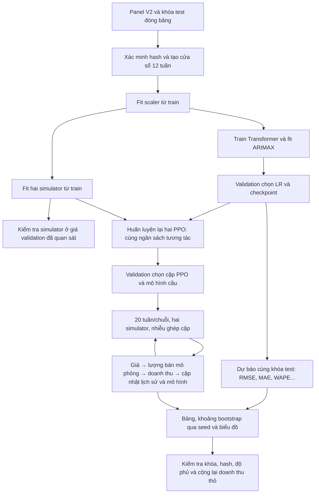

# Cách đọc và tái lập phép đối sánh

Nguồn phương pháp: [bài Song (2026), DOI 10.1007/s10791-026-10745-2](https://link.springer.com/article/10.1007/s10791-026-10745-2). Cấu hình thực thi và các giả định của bản tái dựng được ghi bên dưới.

Đây là phép so sánh chạy lại bằng mã của dự án, dùng bản tái dựng phương pháp Song đã có trong `experiments/song_forecast.py`. Không gọi các điểm mới là điểm của tác giả. Bảng này dùng checkpoint train-only cho cả hai vai trò dự báo và định giá; không trộn với bảng Phase 5 đã refit train+validation.

## Dữ liệu và phép chia

Giữ nguyên panel V2 và danh sách khóa `(sku, week)` đã đóng băng. Chia theo lịch toàn dataset: `floor(0.70*T)` tuần train, đến `floor(0.85*T)` là validation, phần còn lại là test. Không chia ngẫu nhiên từng hàng.

| Thuộc tính | UCI | M5 |
|---|---:|---:|
| Số tuần train/validation/test | 37 / 8 / 9 | 193 / 42 / 42 |
| Chuỗi đủ điều kiện từ train | 3.387 | 29.069 |
| Chuỗi có khóa test | 2.774 | 29.069 |
| Khóa test dùng đối sánh dự báo | 18.542 | 1.220.898 |
| Cửa sổ train neural hợp lệ | 39.366 | 3.826.026 |

Thông số chuẩn hóa, tham số ARIMAX và simulator chỉ fit từ train. Validation chọn learning rate/checkpoint. Dự báo là rolling một bước: được dùng dữ liệu quan sát của các tuần trước, không dùng lượng bán của tuần đang dự báo. Giá hiện tại là giá quan sát đã biết trong phép đánh giá dự báo có điều kiện, không phải giá tối ưu do mô hình tự quyết định.

Định giá chỉ chạy trên M5. Phạm vi là mọi chuỗi có ARIMAX fit được, kernel có biến thiên giá và đủ lịch sử nhân quả; hiện có 18.055 chuỗi. Giữ 20 tuần test đầu, tức 361.100 quyết định/phương pháp/seed/simulator. Không loại chuỗi theo kết quả test. Một số chuỗi không đủ điều kiện định giá vẫn có mặt trong bảng dự báo đầy đủ.

## Luồng xử lý

Ở vòng định giá, lượng bán tương lai lấy từ simulator. Mỗi policy giữ lịch sử và phản hồi riêng. Không dùng lượng bán test thật làm đáp án cho một giá mới. Mọi SKU bắt đầu cùng lịch sử trước kỳ; cặp mô hình cầu được khôi phục trước khi chấm SKU tiếp theo. Nhiễu simulator độc lập với RNG chọn hành động/fine-tune.

Actor/critic PPO được giữ cố định khi chấm test; phần học trực tuyến trong evaluation là cập nhật mô hình cầu. Hai simulator dùng chung kernel fit từ train, bản lag điều chỉnh thêm theo lịch sử gần nhất; đây là hai đặc tả để kiểm tra độ nhạy, không phải hai phép xác nhận nhân quả độc lập.

## Kiến trúc và siêu tham số thực sự chạy

| Thành phần | Cấu hình |
|---|---|
| Transformer | Lịch sử `12×9`; Linear `9→128` và positional embedding học được; 4 encoder, 8 head, FFN 512, dropout 0,1; lấy token lịch sử cuối, LayerNorm, ghép 8 feature hiện tại; head `136→128→1`; 813.825 tham số |
| Train Transformer | Adam; LR ứng viên 0,001 và 0,0003 ở seed 42; chọn theo micro RMSE validation ở đơn vị gốc; các seed còn lại dùng LR đã chọn |
| Dừng Transformer | Tối đa 30 epoch, tối thiểu 5, patience 5; MSE lượng bán z-score, clip gradient 1; UCI batch 512 FP32; M5 batch 4096 BF16 lúc train, FP32 lúc chấm |
| ARIMAX | SARIMAX order `(1,0,0)`, biến ngoại sinh giá chuẩn hóa, tối thiểu 12 cặp, tối đa 50 vòng tối ưu; tham số/scaler riêng từng chuỗi |
| Grid ARIMAX | 41 giá cách đều trong miền train, thêm giá hiện tại; tối đa 42 ứng viên; tối đa hóa giá × lượng dự báo; hòa chọn gần giá hiện tại rồi giá thấp hơn |
| PPO với ARIMAX | Actor và critic riêng, mỗi mạng `2×32 Tanh`; 9 feature theo serving + one-hot toàn roster 18.055 chuỗi (tổng 18.064 đầu vào) |
| PPO với Song | Actor và critic riêng, mỗi mạng `3×256 ReLU`; 31 feature gồm lịch sử lượng/giá, lịch, dự báo và đạo hàm theo giá |
| PPO chung | LR 0,0003; gamma 0,99; GAE 0,95; clip 0,2; batch 64; rollout 256; 6 epoch cập nhật; 8.192 tương tác train; entropy 0,005 cho ARIMAX, 0 cho Song |
| Chọn PPO | Doanh thu validation Gaussian, một đại diện có tổng lượng train lớn nhất cho mỗi cửa hàng/nhóm; mỗi 2.048 bước và cuối lượt; lưu đúng cặp PPO–mô hình cầu |
| Phản hồi Song | Cập nhật mỗi 10 tương tác, bộ đệm tối đa 200, batch tối đa 32, Adam LR 0,0001, clip gradient 1 |
| Phản hồi ARIMAX | Dùng `final_system/feedback.py`: cập nhật beta với ridge 32, ít nhất 4 và tối đa 32 phản hồi gần nhất |
| Simulator | Gaussian/Silverman và lag-adjusted alpha 0,75, ratio limit 2; miền giá quan sát từ train, không áp biên đổi giá ±10% |
| Lặp độc lập | Seed 42, 123, 456, 789, 1024 |

Các cấu hình triển khai như batch M5, ngân sách PPO và quy tắc chọn đại diện là lựa chọn được công bố của lượt này. Mạng PPO ARIMAX được huấn luyện lại cho roster mới; không dùng checkpoint phục vụ cũ chỉ có mười chuỗi. One-hot mở rộng khiến mạng có nhiều trọng số ở lớp đầu dù chỉ có hai lớp ẩn. Không suy ra mô hình nhẹ hơn chỉ từ số lớp.

## Độ đo và công thức

Với lượng bán thật `y_i`, dự báo `ŷ_i`, `N` khóa chung, `e_i=ŷ_i−y_i`:

- `RMSE = sqrt(sum(e_i²)/N)`; `MAE = sum(abs(e_i))/N`.
- `WAPE(%) = 100*sum(abs(e_i))/sum(y_i)`; mẫu số 0 thì không xác định.
- `MAPE_positive(%) = 100*mean(abs(e_i)/y_i | y_i>0)`; báo kèm số nhãn dương. Không bỏ nhãn 0 khỏi RMSE/MAE/WAPE.
- `R² = 1−sum(e_i²)/sum((y_i−mean(y))²)`; mẫu số 0 thì không xác định.
- `Bias = mean(e_i)`; dương là dự báo dư.
- Loss train là `mean((ŷ_z−y_z)²)` trên z-score train. Validation chọn epoch bằng RMSE sau hoàn nguyên đơn vị; hai đường này khác thang đo.

Tính micro metric từ tổng lỗi từng hàng, không lấy trung bình RMSE các cửa hàng. UCI và M5 được báo riêng. Nhánh full M5 ghi `ARIMAX + fallback`: tuần trước cho chuỗi không fit được. Nhánh `arimax_available` dùng cùng 766.332 khóa có ARIMAX cho **mọi** mô hình.

Doanh thu seed `s`: `R_s = sum_{sku,t}(p_{s,sku,t} * q_simulated_{s,sku,t})`. Uplift ghép cặp của A so với B: `u_s = 100*(R_A,s/R_B,s−1)`. Báo trung bình `u_s`, số seed thắng, và percentile 2,5/97,5 của 10.000 lần bootstrap năm cặp seed nguyên vẹn. Giảm RMSE dùng `100*(RMSE_Song,s−RMSE_A)/RMSE_Song,s`.

Đơn vị bootstrap là toàn bộ lần chạy seed; không coi hàng triệu tuần là hàng triệu lần huấn luyện độc lập. Vùng tô đường doanh thu lũy kế là min–max qua seed, không phải khoảng tin cậy. Năm seed cung cấp bằng chứng hạn chế; không tự gọi kết quả có ý nghĩa thống kê chỉ vì cả năm lần cùng thắng.

Accuracy, F1, AUC, IoU, mAP, CMC và độ đo ẩn tin không tương ứng với đầu ra hồi quy nhu cầu/định giá của đề tài này. Không bổ sung chúng bằng cách tùy ý biến lượng bán thành lớp.

## Chi phí tính toán

Đây là bậc tính toán theo cấu trúc, không thay thế thời gian đo trên máy. Gọi `L` là số lớp encoder, `T` số tuần lịch sử, `d` width, `f` FFN, `n` số mẫu, `E` số epoch và `K` số giá ứng viên.

| Thành phần | Chi phí chính |
|---|---|
| Mean-4 / tuần trước | O(4) / O(1) mỗi dự báo |
| ARIMAX(1,0,0) | O(n) mỗi lần tính likelihood với state dimension cố định; fit lặp I lần xấp xỉ O(I*n); suy luận một bước O(1) |
| Lưới ARIMAX | O(K), K≤42; không fit lại SARIMAX tại từng giá |
| Transformer forward | O(L*(T²*d + T*d² + T*d*f)); bộ nhớ attention O(L*H*T²) ngoài activation/weight |
| Transformer train | Xấp xỉ O(E*n*chi phí forward) với hệ số backprop; minibatch giới hạn bộ nhớ GPU |
| MLP policy | O(sum_j(d_j*d_{j+1})) mỗi lần suy luận; PPO còn phụ thuộc rollout, batch, số epoch cập nhật và cả actor/critic |
| Gaussian kernel | Fit LOO của implementation này O(n_train²) mỗi chuỗi; dự báo tại một giá O(n_train) |
| Phản hồi Song | Forward/gradient khi dựng state; thêm một bước backprop minibatch sau mỗi 10 tương tác |

So sánh tài nguyên cần đọc thêm `elapsed_seconds`, `epoch_seconds`, `seconds` và số chuỗi train đã tương tác trong artifact. 8.192 bước là ngân sách đối sánh cố định, chưa chứng minh hội tụ và chưa bao phủ mọi SKU trong train.

## Những kết luận được phép rút ra

1. Bảng dự báo có thể kết luận hơn/kém bản Song tái dựng trên cùng khóa, cách chia và đơn vị của dự án.
2. Bảng doanh thu chỉ kết luận trong từng simulator và cohort đã nêu. Kiểm tra simulator ở giá validation quan sát được là điều kiện cần, chưa chứng minh đáp ứng cầu khi can thiệp giá.
3. Gaussian hiện không vượt mốc tuần trước ở kiểm tra validation; phải đọc kết quả hai simulator song song, không chỉ chọn môi trường có thứ hạng thuận lợi.
4. Không so trực tiếp RMSE/doanh thu mới với số trong bài báo nếu chưa đồng nhất cohort, nhãn, đơn vị và chuẩn hóa. Chưa có mã nguồn tác giả và đầy đủ chi tiết để nhận là tái lập chính xác.
5. Test V2 đã được xem trước đó; đây là khảo sát bổ sung. Muốn có bằng chứng xác nhận độc lập cần holdout mới; muốn chứng minh lợi ích kinh doanh cần thực nghiệm can thiệp thích hợp ngoài simulator.

`verify` chỉ báo hoàn tất sau khi đủ khóa dự báo, đủ ma trận seed/phương pháp/simulator, hash khớp và doanh thu cộng lại từ các quyết định thô. Không thay số còn thiếu bằng nội suy hoặc kết quả lượt nhỏ.
